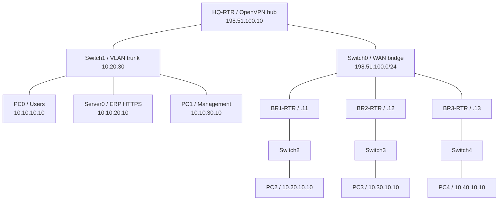

# demo_cs347 — OpenVPN thật bằng Linux network namespace

**Tự thực hành từng bước:** [Hướng dẫn demo bằng tiếng Việt](docs/HUONG_DAN_DEMO.md) — lệnh, kết quả cần thấy, lời thuyết trình và xử lý lỗi.

Lab HQ + 3 chi nhánh cho đồ án CS347, dựng bằng một kernel Linux. Chạy trên Ubuntu 24.04 hoặc Ubuntu 24.04 trong WSL2; không cần VMware, VirtualBox hay Docker. WSL2 vẫn sử dụng ảo hóa nhẹ bên dưới.

OpenVPN, PKI, routing, VLAN, firewall và gói tin đều chạy thật. Internet trong lab là mạng WAN cô lập, không kết nối Internet bên ngoài. Đây là lab trên một máy; clone repo trên máy khác sẽ tạo một lab độc lập, không tự nối VPN hai laptop với nhau.

## Bám theo sơ đồ Packet Tracer

| Thiết bị trong ảnh | Namespace Linux | Địa chỉ |
|---|---|---|
| Switch0 — WAN/ISP | `cs347-internet`, bridge `wanbr` | Underlay 198.51.100.0/24 |
| HQ-RTR | `cs347-hq` | WAN 198.51.100.10 (giả định) |
| Switch1 | `cs347-hqsw`, bridge VLAN | Trunk VLAN 10/20/30 (giả định) |
| PC0 — Users | `cs347-users` | 10.10.10.10/24, gateway .1 |
| Server0 — ERP | `cs347-erp` | 10.10.20.10/24, gateway .1 |
| PC1 — Management | `cs347-mgmt` | 10.10.30.10/24, gateway .1 |
| BR1-RTR | `cs347-br1` | WAN 198.51.100.11; LAN 10.20.10.1/24 |
| Switch2 / PC2 | `cs347-br1sw` / `cs347-pc1` | PC2: 10.20.10.10/24 |
| BR2-RTR | `cs347-br2` | WAN 198.51.100.12; LAN 10.30.10.1/24 |
| Switch3 / PC3 | `cs347-br2sw` / `cs347-pc2` | PC3: 10.30.10.10/24 |
| BR3-RTR | `cs347-br3` | WAN 198.51.100.13; LAN 10.40.10.1/24 |
| Switch4 / PC4 | `cs347-br3sw` / `cs347-pc3` | PC4: 10.40.10.10/24 |

Tên `pc1/pc2/pc3` trong script nghĩa là PC của chi nhánh 1/2/3, tương ứng PC2/PC3/PC4 trong ảnh.

Ảnh được cung cấp chưa ghi cấu hình HQ, VLAN hoặc ACL. Các mục đánh dấu giả định dựa trên đoạn chat gốc, chưa phải cấu hình được trích xuất từ file `.pka`. Khi có file hoặc bảng địa chỉ HQ, cần đối chiếu lại. Linux bridge thay chức năng chuyển mạch L2; Linux gateway thay router Cisco, không chạy Cisco IOS.



## Chạy trên máy khác

### Windows

Cần WSL2 với Ubuntu 24.04. Nếu chưa có, mở PowerShell quản trị:

```powershell
wsl --install -d Ubuntu-24.04
```

Khởi động lại nếu Windows yêu cầu; mở Ubuntu để hoàn tất tạo người dùng. Trong terminal Ubuntu:

```bash
sudo apt-get update
sudo apt-get install -y git
git clone https://github.com/vutechtips/demo_cs347.git
cd demo_cs347
sudo bash scripts/install.sh
sudo bash scripts/start-lab.sh
```

Máy đã có WSL có thể dùng launcher PowerShell từ thư mục repo:

```powershell
.\lab.cmd install
.\lab.cmd start
.\lab.cmd erp
```

Launcher dùng tài khoản root của distro Ubuntu-24.04 để dựng namespace. Không thay đổi firewall hay bảng định tuyến của Windows. Ubuntu distro và gói phụ thuộc cần Internet lúc cài; lab đã cài xong có thể demo offline.

`lab.cmd` dùng được cả PowerShell và CMD, không cần đổi execution policy. `lab.ps1` là launcher tùy chọn cho máy cho phép chạy script PowerShell và hỗ trợ tên distro khác.

### Ubuntu trực tiếp

```bash
git clone https://github.com/vutechtips/demo_cs347.git
cd demo_cs347
sudo bash scripts/install.sh
sudo bash scripts/start-lab.sh
```

`start-lab.sh` dựng mạng và kết nối VPN rồi dừng; không tự chạy testcase. Lần đầu tạo CA/chứng chỉ; lần sau dùng lại. Runtime nằm trong `/var/lib/cs347-lab`, ngoài repo.

## Demo trước giám khảo

Mở 3 terminal Ubuntu, cùng vào thư mục repo:

```bash
# Terminal 1: trạng thái và firewall
sudo bash scripts/demo.sh status
# Terminal 2: xem log HQ trực tiếp; Ctrl+C để thoát
sudo bash scripts/demo.sh log
# Terminal 3: thực hiện từng bài bên dưới
```

| Lệnh | Kết quả | Ý nghĩa |
|---|---|---|
| `sudo bash scripts/demo.sh erp` | `ERP-HQ`, PASS | PC BR1 truy cập ERP qua TCP/443 |
| `sudo bash scripts/demo.sh mgmt` | Timeout, PASS + counter tăng | Chứng minh HQ firewall chặn Management |
| `sudo bash scripts/demo.sh branch` | `BR2-HTTPS`, PASS | BR1 đến BR2 qua hub, TCP/443 |
| `sudo bash scripts/demo.sh deny` | Ping thất bại, PASS + counter tăng | BR1 đến BR2 ICMP bị default deny |
| `sudo bash scripts/demo.sh status` | Client và counter thật | Đối chiếu kết nối với các rule |

Timeout chỉ là hiện tượng; script còn xác nhận counter của rule chặn tăng để tránh nhầm lỗi mạng với firewall hoạt động đúng. HTTPS xác minh chứng chỉ demo bằng `--cacert`, không bỏ kiểm tra TLS.

### Bắt gói WAN và tunnel

```bash
# Terminal 1: chỉ thấy IP WAN, UDP/1194
sudo bash scripts/demo.sh wan
# Terminal 2: thấy IP LAN gốc và TCP/443
sudo bash scripts/demo.sh tunnel
# Terminal 3: tạo lưu lượng
sudo bash scripts/demo.sh erp
```

Trên WAN: `198.51.100.11 -> 198.51.100.10`, UDP/1194. Trên tunnel: `10.20.10.10 -> 10.10.20.10`, TCP/443. HTTPS vẫn mã hóa nội dung ứng dụng ngay cả trên `tun0`; không nên nói có thể đọc HTTP plaintext từ bài HTTPS này. Điểm minh họa là lớp encapsulation của VPN và địa chỉ LAN/WAN. Ctrl+C dừng tcpdump, không dừng VPN.

### Thu hồi BR2 và khôi phục

```bash
sudo bash scripts/revoke-br2.sh
sudo bash scripts/restore-br2.sh
```

Revoke: lưu bản chứng chỉ cũ cho bài thử, dùng Easy-RSA thu hồi và cập nhật CRL; ngắt BR2, kết nối lại bằng chứng chỉ cũ; kiểm tra log mới của HQ có `certificate revoked`. Thu hồi không được coi là tự động ngắt ngay phiên TLS đang chạy, nên script chủ động reconnect.

Restore: cấp khóa và chứng chỉ MỚI cho BR2, rồi kết nối lại. Chứng chỉ cũ vẫn bị thu hồi; không sửa CRL để làm nó hợp lệ trở lại. Cấp lại khác với hủy việc thu hồi.

## Giải thích cấu hình

- Namespace cô lập interface, bảng route và firewall từng thiết bị; các thiết bị dùng chung kernel.
- Veth là dây mạng hai đầu; bridge là switch L2. HQ dùng một trunk và ba VLAN, chi nhánh dùng switch access.
- Pool VPN: 10.255.0.0/24; HQ .1, BR1 .2, BR2 .3, BR3 .4.
- `route` đưa mạng LAN chi nhánh từ kernel HQ vào tunnel. CCD `iroute` cho OpenVPN biết chi nhánh nào sở hữu mạng đó.
- Server đẩy route các LAN đến client; route LAN của chính client vẫn là mạng trực tiếp.
- Không bật `client-to-client`, không dùng DCO trong lab để lưu lượng liên chi nhánh đi qua kernel HQ và nftables. Xem [OpenVPN 2.6 manual](https://openvpn.net/community-docs/community-articles/openvpn-2-6-manual.html).
- Firewall HQ cho phép các chi nhánh đến ERP/443 và BR1 đến PC BR2/443; chặn Management và các luồng mới khác. Gói trả lời dùng `ct state established,related`.
- WAN không có route LAN trực tiếp, không có NAT. Muốn đến ERP phải đi qua VPN.
- Dịch vụ Python HTTPS là endpoint kiểm thử, không phải ứng dụng ERP đầy đủ. PC3 chạy thêm endpoint HTTPS để demo BR1 -> BR2.

## Kiểm thử và dừng lab

```bash
sudo bash scripts/test-lab.sh
sudo bash scripts/test-capture.sh
sudo bash scripts/stop-lab.sh
```

Stop chỉ kết thúc tiến trình trong namespace mang tên `cs347-*`, rồi xóa các namespace lab; giữ PKI/log để dùng lại. Nếu muốn bỏ runtime, hãy sao lưu log cần thiết, dừng lab và tự quản lý thư mục `/var/lib/cs347-lab`.

## Các file chính

```text
lab.cmd / lab.ps1          Launcher cho Windows/WSL
scripts/start-lab.sh        Topology + PKI + OpenVPN + HTTPS
scripts/stop-lab.sh         Dừng và dọn namespace
scripts/demo.sh             Các bài demo theo lựa chọn
scripts/revoke-br2.sh       Thu hồi + chứng minh từ chối
scripts/restore-br2.sh      Cấp lại chứng chỉ
config/hq.nft              Policy tại HQ
config/branch.nft          Policy gateway chi nhánh
services/https.py          HTTPS endpoint thật
docs/VALIDATION.md         Kết quả kiểm thử
```

## Khi gặp lỗi

- Thiếu lệnh: chạy `sudo bash scripts/install.sh`.
- Namespace đã tồn tại: chạy stop trước start; không start hai lab cùng lúc.
- Tunnel timeout: xem `/var/lib/cs347-lab/logs/hq.log` và `br1.log`/`br2.log`/`br3.log`.
- Thiếu TUN/permission: xác nhận WSL VERSION 2 bằng `wsl -l -v`, dùng Ubuntu 24.04 và chạy qua sudo/root.
- Revoke chưa restore rồi dừng: lần start sau cấp lại BR2 nếu file chứng chỉ active không còn, giữ serial cũ trong CRL.
- Không thấy ERP: kiểm tra log dịch vụ, `sudo ip netns exec cs347-erp ss -lntp`, trạng thái VPN và counter HQ.
- Khi WSL bị tắt hoặc Windows khởi động lại, chạy start lại. Chứng chỉ vẫn giữ nhưng namespace/tiến trình không tồn tại.

Không commit private key, runtime hoặc PCAP. Mỗi người clone repo sẽ tự sinh CA/key riêng; đây là lab học tập cô lập, không phải cấu hình production.
